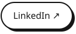

<picture><source media="(prefers-color-scheme: dark)" srcset="assets/hero-dark.svg" /></picture>

<a href="https://www.linkedin.com/in/amitgautam06/"><picture><source media="(prefers-color-scheme: dark)" srcset="assets/btn-linkedin-dark.svg" /></picture></a>
<a href="mailto:work.amit.gautam@gmail.com"><picture><source media="(prefers-color-scheme: dark)" srcset="assets/btn-email-dark.svg" /></picture></a>
<picture><source media="(prefers-color-scheme: dark)" srcset="assets/btn-views-dark.svg" /></picture>

Ex-founder and builder. I founded Distance Connect, a student–mentor platform, and took it from zero to 5,000+ registered students, shaping 15+ features through 500+ user interviews. Now I'm at ClickPost, running the acquisition funnel for its Shopify app from first list to paid conversion, and building the tools the team runs on. I'm finishing a B.Tech at Delhi Technological University in 2027.

 

<picture><source media="(prefers-color-scheme: dark)" srcset="assets/stats-dark.svg" /></picture>

 

<picture><source media="(prefers-color-scheme: dark)" srcset="assets/work-head-dark.svg" /></picture>
<a href="https://www.distanceconnect.in/"><picture><source media="(prefers-color-scheme: dark)" srcset="assets/work-distance-connect-dark.svg" /></picture></a>
<a href="https://gtm-outbound-crm.vercel.app/"><picture><source media="(prefers-color-scheme: dark)" srcset="assets/work-outbound-crm-dark.svg" /></picture></a>
<picture><source media="(prefers-color-scheme: dark)" srcset="assets/work-clickpost-dark.svg" /></picture>

 

<picture><source media="(prefers-color-scheme: dark)" srcset="assets/stack-dark.svg" /></picture>

  

<a href="mailto:work.amit.gautam@gmail.com"><picture><source media="(prefers-color-scheme: dark)" srcset="assets/footer-dark.svg" /></picture></a>

 

Design inspired by [aahil-khan.xyz](https://aahil-khan.xyz), which drew on [yevtam.com](https://yevtam.com) (dock, cursor) and [ajvadlaseen.com](https://ajvadlaseen.com) (type, borders, shadows). This README follows [Aahil Khan's profile README](https://github.com/aahil-khan/aahil-khan), and my portfolio sites are forks of his open-source [portfolio-canvas](https://github.com/aahil-khan/portfolio-canvas), used under the MIT licence. The content, numbers and projects here are mine; none of his personal content is included. Thanks, Aahil.
