<picture><source media="(prefers-color-scheme: dark)" srcset="assets/hero-dark.svg" /></picture>

<a href="https://www.amitgautamwork.com"><picture><source media="(prefers-color-scheme: dark)" srcset="assets/btn-site-dark.svg" /></picture></a>
<a href="https://www.amitgautamwork.com/amit-gautam-resume.pdf"><picture><source media="(prefers-color-scheme: dark)" srcset="assets/btn-resume-dark.svg" /></picture></a>
<a href="https://www.linkedin.com/in/amitgautam06/"><picture><source media="(prefers-color-scheme: dark)" srcset="assets/btn-linkedin-dark.svg" /></picture></a>
<a href="mailto:work.amit.gautam@gmail.com"><picture><source media="(prefers-color-scheme: dark)" srcset="assets/btn-email-dark.svg" /></picture></a>
<picture><source media="(prefers-color-scheme: dark)" srcset="assets/btn-views-dark.svg" /></picture>

GTM engineer and ex-founder. I run outbound for ClickPost end to end, from list building and copy to live demos and paid conversion, and I build the tooling behind it. Before that I founded Distance Connect. There's also a [more playful version of my site](https://www.amitgautamwork.com/canvas), if you're on a desktop.

 

<picture><source media="(prefers-color-scheme: dark)" srcset="assets/stats-dark.svg" /></picture>

 

<picture><source media="(prefers-color-scheme: dark)" srcset="assets/work-head-dark.svg" /></picture>
<a href="https://www.amitgautamwork.com/work/outbound-crm"><picture><source media="(prefers-color-scheme: dark)" srcset="assets/work-outbound-crm-dark.svg" /></picture></a>
<a href="https://www.amitgautamwork.com/work/shopflo-lead-pipeline"><picture><source media="(prefers-color-scheme: dark)" srcset="assets/work-shopflo-dark.svg" /></picture></a>
<a href="https://www.amitgautamwork.com/work/eu-withdrawal-rights"><picture><source media="(prefers-color-scheme: dark)" srcset="assets/work-eu-offer-dark.svg" /></picture></a>
<a href="https://www.amitgautamwork.com/work/distance-connect"><picture><source media="(prefers-color-scheme: dark)" srcset="assets/work-distance-connect-dark.svg" /></picture></a>

 

<picture><source media="(prefers-color-scheme: dark)" srcset="assets/stack-dark.svg" /></picture>

  

<a href="mailto:work.amit.gautam@gmail.com"><picture><source media="(prefers-color-scheme: dark)" srcset="assets/footer-dark.svg" /></picture></a>

 

Design inspired by [aahil-khan.xyz](https://aahil-khan.xyz), which drew on [yevtam.com](https://yevtam.com) (dock, cursor) and [ajvadlaseen.com](https://ajvadlaseen.com) (type, borders, shadows). This README follows [Aahil Khan's profile README](https://github.com/aahil-khan/aahil-khan), and [amitgautamwork.com](https://www.amitgautamwork.com) is a fork of his open-source [portfolio-canvas](https://github.com/aahil-khan/portfolio-canvas), used under the MIT licence. The content, numbers and projects here are mine; none of his personal content is included. Thanks, Aahil.
